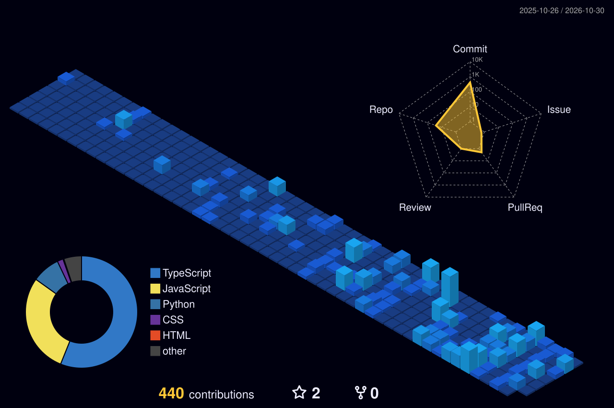

<!-- ═══════════════════════════════════════════════════════════════ -->
<!--  RACHIT MITTAL — GitHub Profile README (v2)                     -->
<!--  Every image here is either generated inside this repo (3D      -->
<!--  graph) or served by a stable renderer — no flaky stat cards.  -->
<!-- ═══════════════════════════════════════════════════════════════ -->

<!-- HERO — capsule-render banner; "twinkling" gives the moving-light effect -->
<div align="center">

</div>

<!-- TYPING LINE — each line is a real, shipped thing, not a slogan -->
<div align="center">

</div>

<!-- QUICK LINKS — badges up top so recruiters reach contact in one glance -->
<div align="center">

[](https://www.linkedin.com/in/rachit-mittal-354767298/)
[](mailto:rachitmittalxc@gmail.com)


</div>

<br/>

<!-- ─── ABOUT ─────────────────────────────────────────────────── -->
## ⚡ About Me

<!-- Code-block bio kept from v1 (it's a good idea) but rewritten with real substance -->
```ts
const rachit = {
  role:        "Full-Stack Engineer · B.Tech CSE @ SRMIST (2027)",
  based:       "Delhi NCR, India 🇮🇳",
  shipping:    "LLM-powered AP automation — Gemini extraction + three-way match engine",
  experience:  ["Doritech Consultancy — Software Trainee", "NileTech — Full-Stack Intern"],
  strengths:   ["End-to-end ownership", "Postgres-first architecture", "Measured performance work"],
  ai_ml:       ["RAG pipelines", "LLM evaluation", "Document extraction / OCR", "NPTEL — NLP"],
  wins:        ["🥈 Bid2Code — 2nd place", "🏅 Botverse — Top 5 of 62 teams"],
  open_to:     "Internships & freelance full-stack / AI work",
};
```

<!-- ─── 3D CONTRIBUTION GRAPH ──────────────────────────────────── -->
<!-- Generated daily by .github/workflows/profile-3d.yml and committed into this repo.
     Swap the filename for: profile-night-rainbow.svg / profile-gitblock.svg / profile-green-animate.svg -->
<div align="center">

</div>

<br/>

<!-- ─── FEATURED WORK ──────────────────────────────────────────── -->
## 🚀 Featured Work

<!-- Two-column card grid built from an HTML table — GitHub allows tables, not CSS grid -->
<table>
<tr>
<td width="50%" valign="top">

### 🧾 Trident Oracle
**AP invoice intake & three-way match engine** · *Doritech*

Ingests invoice PDFs/photos → Gemini Flash extraction (Tesseract fallback) → three-way match against PO & Goods Receipt → auto-posts clean invoices, routes exceptions to Telegram.

`450+ unit tests` `mypy --strict` `Postgres SKIP LOCKED queue` `RLS on every table`

  

</td>
<td width="50%" valign="top">

### 🧪 Strong Path Diagnostics
**B2B health-testing operations platform** · *NileTech*

Full testing lifecycle — scheduling → sample logging → results → review → broadcast — plus a client portal. JSONB form engine ships new test types with zero deploys.

`13-table schema` `7-stage status pipeline` `append-only audit log`

  · [**Live ↗**](https://strongpath-diagnostics.vercel.app)

</td>
</tr>
<tr>
<td width="50%" valign="top">

### 🏛️ Atrium
**Interactive 3D design-review platform** · *ArchScale Hackathon*

Orbit + first-person walkthrough, clickable spec sheets, comments pinned to exact 3D coordinates, live multi-reviewer sync.

`−74% HDRI size` `idle draw calls → 0` `−62 KB gzip`

  · [**Repo**](https://github.com/RachitMittal-20/Atrium) · [**Live ↗**](https://atrium-ten-rho.vercel.app)

</td>
<td width="50%" valign="top">

### 🎬 ContentIQ
**AI video intelligence (RAG)**

Compares two YouTube videos side by side — transcript extraction, MiniLM embeddings, ChromaDB search, cited answers streamed over SSE.

`documented trade-offs` `Render + Vercel deploy`

  · [**Repo**](https://github.com/RachitMittal-20/ContentIQ) · [**Live ↗**](https://content-iq-lake.vercel.app)

</td>
</tr>
<tr>
<td colspan="2" valign="top">

### 🔬 RagForge — Production RAG with Evaluation & Observability
Conversational RAG over private docs with query reformulation, plus an automated eval layer scoring **6 metrics per query** (faithfulness, hallucination risk, context precision, relevancy, cost…) on a live analytics dashboard.
   · [**Repo**](https://github.com/RachitMittal-20/RagForge)

</td>
</tr>
</table>

<br/>

<!-- ─── TECH STACK ─────────────────────────────────────────────── -->
## 🛠️ Tech Stack

<!-- skillicons.dev renders glossy rounded icons — far cleaner than rows of shields badges -->
<div align="center">

**Languages & Frontend**
<br/><br/>


<br/><br/>

**Backend & Data**
<br/><br/>


<br/><br/>

**DevOps & Tools**
<br/><br/>


<br/><br/>

**AI / ML**
<br/><br/>
<!-- Not in skillicons, so these use shields badges -->


</div>

<!-- ─── ENGINEERING PRINCIPLES ─────────────────────────────────── -->
## 🧭 How I Build

<!-- Short and specific — signals judgement, which badges can't -->
- **The database is the security boundary.** Postgres Row Level Security over hand-rolled per-request checks.
- **Fewer moving parts.** A job queue on Postgres `FOR UPDATE SKIP LOCKED` before reaching for Redis or Celery.
- **Measure, then optimise.** Every performance change in my repos comes with a before/after number.
- **Pure core, tested hard.** Business logic stays I/O-free so it can be unit-tested to the boundary cases.

<br/>

<!-- ─── STREAK ─────────────────────────────────────────────────── -->
<!-- Kept from v1 — the only stats widget that was actually rendering -->
<div align="center">

</div>

<!-- FOOTER WAVE — mirrors the header palette -->
<div align="center">

</div>
